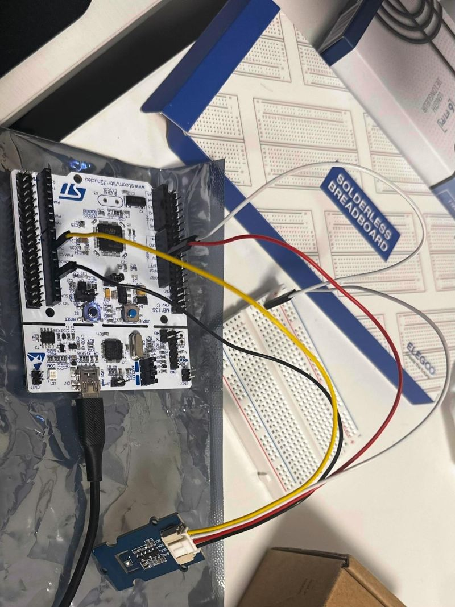

# SGP30 Driver for CO2 Readings

A bare-metal SGP30 Driver to read and display CO2 data from scratch on an STM32F446RE (Cortex-M4) with a real-time Python serial visualizer.

[Real-Time CO2 Detection Working Demonstration](https://youtu.be/XKPByFFPy3I)

## System Architecture

* In this project, I showcase my knowledge and understanding of the complete I2C protocol needed to communicate with the SGP30 hardware to get consistent, repeated CO2 data that can be displayed in real-time. 
* I also showcased state management to maintain correct state transitions and correctly relay and receive data from the SGP30 hardware.
* AI was ONLY used to help with the GUI so I could spend more time focusing on developing my embedded C skills and move on to more complex projects.
* All the system logic including the I2C interrupt was implemented in the main.c file, so not much separation of concern which would be an area of improvement, however my GPIO Configuration setup allowed for more quick and robust utilization of more GPIO pins. 


## Key Technical Highlights

* **Utilizing I2C for SGP30 communication:** Since the SGP30 sensor utilizes the I2C protocol, I initialized according to the specs provided in the reference sheet along with creating a complete lifecycle of every case the interrupt could hit based on which interrupt flag gets triggered and which state we have transitioned to.
* **UART utilization to display CO2 data:** Used USART2 to send data to the ttyACM* file so that the python script can run on that file. This is possible because the TX and RX pins are soldered to the ST-LINK debugger. 
* **State Transitions:** Utilized a state machine to ensure correct transitions to the next states because flags alone don't tell you which part of the process you are currently on. For example SGP30 needs 2 bytes to initialize it and then another 2 bytes to instruct it to send measurement data. 

## What you need to get it working

* Work in a Linux system (I did this in Ubuntu 24.04)
* An STM32F446RE board
* An SGP30 Sensor

## Setup & Usage

1. Install CMake:
   ```bash
   sudo apt install cmake
   ```

2. Clone my GitHub repo locally.

3. Run in the parent directory:
   ```bash
   cmake -S . -B build
   cmake --build build --target flash
   ```

4. In another terminal, run:
   ```bash
   python3 read_sgp30_data.py
   ```

5. See the CO2 values populate on the graph in real-time.

   ---

   > **Note:** If you are working in Windows and have VS Code running on a Linux virtual machine, you need to pass the USB traffic from Windows to your virtual machine.
   >
   > I was using WSL 2, so I used the below command in administrative PowerShell:
   > ```powershell
   > usbipd attach --wsl --busid <BUSID>
   > ```
   > *(You can get this number by running `usbipd list`)*

6. The picture below demonstrates how to attach the jumper cables, where PB6 and PB7 are your I2C1_SCL (Yellow cable) and I2C1_SDA (White cable) lines. Your Red wire is connected to 5V and your Black wire is connected to GND.

   


## Future Improvements

- **Add a buffer between I2C and UART:** To ensure no data gets dropped as the I2C hands off data to the UART DR register, a buffer between them would ensure that both can operate on their own time. 
- **Add I2C Error Interrupt:** Ensure that recovery is available anytime any one of the error flags gets triggered so that the system can continue to operate smoothly. 
- **Add more modularity and separation of concerns:** Create more modularity with the software so that more hardware systems can be added in the future. Additionally, separate the higher level (main while loop) code from the primitive drivers so that testing can be done independently on the high level logic. 